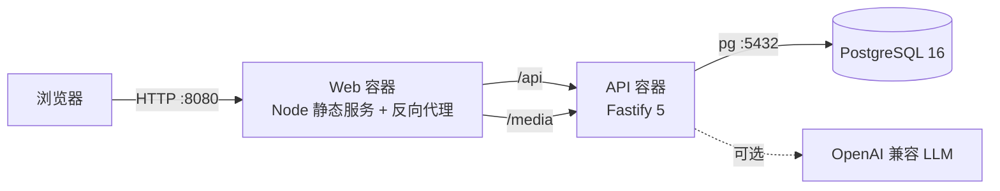

# 声屿 · 在声音里靠岸

一个**原创视觉与交互**的音乐流媒体全栈原型：功能对齐竞品核心能力（发现、搜索、艺人/专辑/歌曲、歌单、音乐库、播客、电台、歌词、队列、订阅、账户、内容管理），并在**可解释推荐、自然语言找歌、播放工作台、键盘无障碍、订阅透明与数据主权**上做出可验证的改进。

- 竞品功能清单与验收范围：[`docs/competitor-analysis.md`](docs/competitor-analysis.md)
- 差异化设计与逐项验证步骤：[`docs/differentiation.md`](docs/differentiation.md)
- 全部假设与范围取舍：[`docs/assumptions.md`](docs/assumptions.md)
- 安全评估报告：[`docs/security-assessment.md`](docs/security-assessment.md)

> 所有艺人、专辑、歌曲、歌词、播客、统计数字均为虚构；音频为脚本合成的 45 秒原创样带；封面与头像是程序化 SVG。项目不包含竞品的 Logo、图片、品牌色或原始素材。

---

## 1. 快速开始（Docker，一键全栈）

前置：Docker 与 Docker Compose。无需 Node、无需外部数据库。

```bash
docker compose up --build
```

- 打开 **http://localhost:8080**
- 数据库为空时 API 自动写入示例目录（10 位音乐人 / 16 张专辑 / 58 首曲目 / 3 档播客 / 2 个演示账号）
- 自定义端口：`WEB_PORT=8090 DB_PORT=5433 docker compose up --build`
- 显式种子（幂等，默认在已有数据时跳过）：`docker compose --profile seed up` 或 `docker compose --profile seed run --rm seed`
- 后台运行：`docker compose up --build -d`
- 清空数据重来：`docker compose down -v`

### 演示账号

| 角色 | 邮箱 | 密码 | 能力 |
| --- | --- | --- | --- |
| 听众 | `demo@shengyu.app` | `demo1234` | 已有点赞、关注、播放历史与歌单 |
| 管理员 | `admin@shengyu.app` | `admin1234` | 额外拥有「内容管理」曲目 CRUD |

> 演示凭据是公开的本地种子数据，不属于敏感信息；生产部署必须删除或改密。

### 无需 `.env` 即可运行

compose 使用本机数据库 `trust` 认证、API 临时随机 JWT 密钥（重启会使会话失效）。正式环境请：

```bash
cp .env.example .env
# 编辑 .env：设置强 JWT_SECRET、COOKIE_SECURE=true，并改用带密码的 DATABASE_URL
```

`.env` 已被 `.gitignore`/`.dockerignore` 排除，仓库中只有占位符 `.env.example`。

---

## 2. 本地开发

前置：Node.js ≥ 22、npm ≥ 10、Docker（仅用于数据库）。

```bash
# 1) 安装依赖
npm install

# 2) 启动 PostgreSQL（只启动 db 服务）
docker compose up -d db

# 3) 可选：复制环境变量（默认值即可跑通）
cp .env.example .env

# 4) 同时启动 API 与 Web
npm run dev
```

- Web（Vite）：http://localhost:5173
- API：http://localhost:3001/api/health
- 若 5432 被占用：`DB_PORT=5433 docker compose up -d db`，并把 `.env` 的 `DATABASE_URL` 改为 `postgres://postgres@localhost:5433/shengyu`
- 单独启动：`npm run dev -w @shengyu/api` / `npm run dev -w @shengyu/web`
- 生产构建：`npm run build`；API：`node apps/api/dist/server.js`；Web：`npm run start -w @shengyu/web`

### 环境变量

| 变量 | 默认 | 说明 |
| --- | --- | --- |
| `PORT` | `3001` | API 端口 |
| `DATABASE_URL` | `postgres://postgres@localhost:5432/shengyu` | 本地开发数据库连接串 |
| `JWT_SECRET` | 空（生成临时随机值） | **生产必填**；留空时重启会失效所有会话 |
| `COOKIE_SECURE` | `false` | HTTPS 部署设为 `true` |
| `ALLOWED_ORIGINS` | localhost/127.0.0.1 的 5173/8080 | 写操作 Origin 白名单 |
| `SEED_ON_EMPTY` | `true` | 目录为空时自动种子 |
| `LLM_BASE_URL` / `LLM_API_KEY` / `LLM_MODEL` | 空 | 可选 OpenAI 兼容端点；不配置则使用离线意图引擎 |
| `LLM_TIMEOUT_MS` | `8000` | LLM 请求超时，失败自动回退 |
| `WEB_PORT` / `DB_PORT` | `8080` / `5432` | compose 对外端口 |

---

## 3. 架构与技术选型



```
.
├── apps/
│   ├── api/                 # Fastify + PostgreSQL API
│   │   ├── db/schema.sql    # 幂等初始化 schema
│   │   ├── media/audio/     # 8 段原创合成样带（45s MP3）
│   │   ├── src/             # app / routes / services / seed
│   │   └── test/            # 38 项 PGlite 集成测试
│   └── web/                 # React + Vite SPA
│       ├── src/             # pages / components / contexts / styles
│       ├── server.mjs       # 生产静态服务 + /api、/media 反向代理
│       └── src/**/*.test.*  # 24 项前端测试
├── scripts/generate-audio.py
├── docs/
├── docker-compose.yml
└── package.json             # npm workspaces
```

### 选型理由

| 选择 | 理由 |
| --- | --- |
| **TypeScript 全栈** | 前后端共享类型、严格模式；与主流生态兼容 |
| **npm workspaces** | 单仓库两个可独立开发/测试/构建的服务，无需额外 monorepo 工具 |
| **Fastify 5** | 高性能、插件化、内置 JSON 解析与成熟生态；便于精细控制安全头/限流 |
| **PostgreSQL 16 + 参数化原生 SQL** | 关系模型清晰；数据量小、查询可读；全部用户值走参数，避免 ORM/字符串拼接风险 |
| **PGlite（WASM PostgreSQL）** | 测试使用真实 PostgreSQL 语义，无需安装数据库，全新 clone 可直接跑 |
| **React 19 + React Router 7 + Vite 8** | 主流稳定组合；SPA 路由与播放器状态管理简单直接 |
| **自研 CSS 设计系统** | 不使用 UI 组件库，保证视觉与竞品明显区隔；纸张编辑风 + 夜航暗色 |
| **jose + bcryptjs + HttpOnly Cookie** | 无原生编译依赖；可验证 JWT、哈希密码、脚本不可读取会话 |
| **Vitest** | 前后端统一测试体验；前端配合 Testing Library |
| **零依赖 Node 静态/代理服务** | 前端容器无需 nginx 或额外运行时依赖，便于离线构建；集中控制 CSP 与代理 |

---

## 4. 已实现功能（验收请对照 `competitor-analysis.md` 第 7 节）

| 模块 | 功能 |
| --- | --- |
| 账户 | 邮箱注册/登录/退出、HttpOnly 会话、双角色（听众/管理员）、资料编辑、改密、全设备退出、JSON 导出、双击确认删号 |
| 发现 | 继续收听、为你挑选（含推荐理由）、此刻流行、新发行、音乐人、电台、播客、编辑歌单；口味调音台 |
| 搜索 | 跨类型搜索（歌曲/艺人/专辑/歌单/播客）、类型筛选、最近搜索、热门搜索 |
| 向导 | 中文自然语言找歌、离线意图引擎、可选 LLM 增强、匹配理由、一键播放/入队 |
| 内容 | 艺人页（关注、热门、专辑、收录、相似）、专辑页（收藏、总时长、更多作品）、歌曲页（歌词、相关、收录）、歌单页（所有者编辑/排序/删除） |
| 音乐库 | 喜欢的歌、自建歌单、关注艺人、收藏专辑、关注播客、最近播放、清空历史 |
| 播放 | 真实音频、播放/暂停/上一首/下一首/进度/音量、随机、循环（关/全部/单曲）、队列跳播/排序/移除/清空、自动续播相似曲目、历史与隐私模式 |
| 工作台 | 舱内视图：同步歌词（滚动高亮/点击跳转）、可编辑队列、曲目信息、推荐理由 |
| 键盘与无障碍 | `Space`、`←/→`、`Shift+←/→`、`L`、`Q`、`/`、`⌘K`、`?`、`Esc`；跳转链接、焦点环、ARIA、焦点陷阱、减少动效 |
| 订阅 | 免费 / 靠岸 Plus / 共听 Studio、当前方案、模拟切换与事件记录、明确不扣款 |
| 设置 | 亮/暗/跟随系统、音质偏好、音量均衡、播放时展开工作台、自动续播、减少动效、隐私模式、通知偏好 |
| 播客/电台 | 节目与单集播放、关注；6 个情绪电台按标签生成播放队列 |
| 管理端 | 概览统计、曲目搜索、新增/编辑/删除、服务端角色校验 |
| 视觉 | 亮色纸张 + 夜航暗色、程序化 SVG 封面/头像、响应式桌面/移动布局、原创 Logo 与排版 |

未实现（明确非验收范围）：真实支付、OAuth、邮件/推送、音乐视频、巡演/周边、离线下载、家庭席位管理、社交共听。详见 `docs/competitor-analysis.md` 第 8 节。

### 快速体验路径

1. 首页按 **⌘K / Ctrl+K**，输入「适合雨夜写代码的歌」→ 回车进入向导，得到带理由的曲目。
2. 点击「播放今日推荐」→ 舱内视图打开；切换「歌词 / 队列 / 信息」，在队列里上移、下移、移除。
3. 返回首页拖动「调音台」三个滑杆，观察推荐与理由更新；喜欢一首歌后回首页查看理由。
4. 搜索「林晚星」→ 打开艺人页 → 关注/取消关注；打开专辑 → 收藏。
5. 账户页开启「隐私模式」→ 播放一首 → 音乐库「最近播放」不新增；关闭后恢复。
6. 订阅页切换方案，账户页与侧栏立即显示；页面明确提示不扣款。
7. 用管理员账号进入「内容管理」，新增/编辑/下架曲目；听众访问返回 403。

---

## 5. 测试

```bash
npm test                # 依次运行 API + Web
npm run typecheck       # 两端 TypeScript 检查
npm run build           # 构建 API 与 Web
```

| 套件 | 数量 | 覆盖 |
| --- | --- | --- |
| `apps/api`（Vitest + PGlite） | **38** | 认证/会话失效、账户导出与删除、管理员授权、目录与搜索、歌单所有权与排序、点赞/关注/收藏、历史与隐私模式、订阅、Origin 守卫、助手引擎 |
| `apps/web`（Vitest + Testing Library） | **24** | 播放队列/随机/循环纯逻辑、播放器状态机、API 错误映射、封面生成、空态/登录门 |
| 合计 | **62** | — |

单独运行：

```bash
npm run test -w @shengyu/api
npm run test -w @shengyu/web
```

后端测试不需要外部数据库：每个测试文件启动独立的 PGlite 实例并应用 `apps/api/db/schema.sql`。Docker 部署的浏览器验收另见上文快速体验路径。

---

## 6. 数据与种子

- Schema：`apps/api/db/schema.sql`，幂等 `CREATE TABLE IF NOT EXISTS`；API 启动时自动应用。
- 种子：`apps/api/src/seed/`；固定 ID + `ON CONFLICT DO NOTHING`，可重复执行。
- 内容：10 位虚构音乐人、16 张专辑、58 首曲目、3 档播客（10 集）、4 个编辑歌单、6 个情绪电台。
- 音频：`scripts/generate-audio.py` 纯合成生成 8 段 45 秒 MP3（96 kbps），无第三方录音；可重新生成：`npm run generate:audio`（需 Python 3 + ffmpeg）。
- 封面：前端 `CoverArt.tsx` 按种子生成 7 种 SVG 图案，按封面亮度自动选择墨色/米白线条与字标。
- 重置：`docker compose down -v` 后重新 `docker compose up --build`。

---

## 7. 安全

- 详见 [`docs/security-assessment.md`](docs/security-assessment.md)。
- 要点：bcrypt 密码哈希、HttpOnly/SameSite JWT + 令牌版本、Zod 校验、全参数化 SQL、Origin 白名单、速率限制、严格 CSP、日志脱敏、隐私模式服务端执行、非 root 容器、数据库仅本机绑定。
- 生产必做：设置 `JWT_SECRET`、启用 HTTPS/`COOKIE_SECURE`、替换演示账号、使用带密码的数据库、移除 `trust` 认证、按需做邮箱验证与 MFA。

---

## 8. 常见问题

| 现象 | 处理 |
| --- | --- |
| `docker compose up` 拉取镜像超时 | 当前网络访问 Docker Hub 受限；预拉取 `node:24-slim`、`postgres:16-alpine` 或配置镜像加速 |
| 8080 / 5432 被占用 | `WEB_PORT=8090 DB_PORT=5433 docker compose up --build`；本地开发同步修改 `.env` 的 `DATABASE_URL` |
| 重启后需要重新登录 | 未设置 `JWT_SECRET` 时会生成临时密钥；在 `.env` / compose 中设置固定强密钥 |
| 没有声音 | 浏览器自动播放策略要求先与页面交互；点击播放按钮并检查音量/静音；样带为 45 秒 |
| 中文显示不佳 | 使用系统中文字体栈；Linux 可安装 Noto Sans/Serif CJK 获得最佳效果 |
| 想看空态 | 注册一个新账号；或手动删除个人歌单/喜欢数据 |
| API 测试偶发等待 | 首次 PGlite 初始化需要下载/加载 WASM；属正常现象 |

---

## 9. 交付与提交阶段

仓库按阶段提交，便于逐项审阅：

1. 竞品分析与功能清单
2. 差异化设计与假设
3. Monorepo 架构、schema 与原创音频素材
4. 后端 API、数据层与测试
5. 前端原创界面、播放器与测试
6. Docker 部署、安全评估、README 与验收

许可证：仅用于内部原型评审；所有虚构内容与合成音频为项目自建素材。