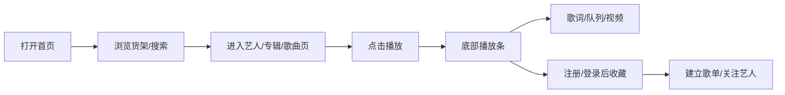
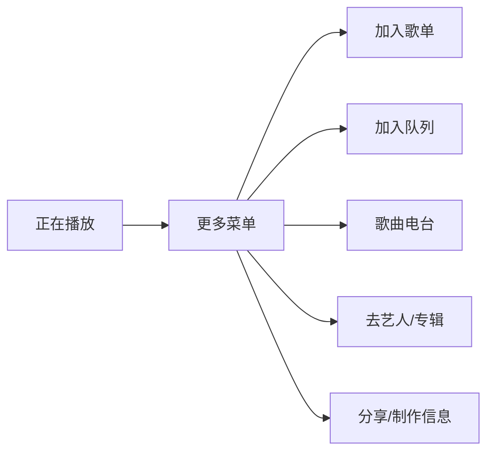

# 竞品功能还原分析

> 分析对象：`materials/screenshots/01.jpeg` – `15.jpeg`（唯一信息来源）
> 分析日期：2026-11-14
> 说明：截图中产品名称、Logo 与部分链接被品牌方或提供方打码；本文以「X」代称该音乐流媒体产品。

## 1. 素材概览

| 文件 | 页面 / 场景 | 关键信息 |
| --- | --- | --- |
| `01.jpeg` | 未登录首页（浏览页） | 顶部导航、全局搜索、左侧 Your Library、Trending songs / Popular artists / Popular albums and singles / Popular radio、底部订阅横幅 |
| `02.jpeg` | 艺人页上半部 | 艺人横幅、月听众、播放/随机/关注、Popular 曲目及播放次数、Artist pick、Discography |
| `03.jpeg` | 艺人页下半部 | 唱片分类卡片、Featuring 歌单、Music videos、On Tour 巡演 |
| `04.jpeg` | Linux 桌面客户端下载页 | Ubuntu Software、Snap、Deb 仓库、命令行安装；品牌被打码 |
| `05.jpeg` | 账户总览（荷兰语） | 顶部 AI 提问框、订阅卡 + Premium 推广、账户/支付/安全隐私/广告/帮助分组 |
| `06.jpeg` | 设置页 | 账户登录方式、语言、音质、音量均衡、紧凑布局、导入音乐、显示、音乐视频/Canvas、播放均衡器 |
| `07.jpeg` | Premium 定价页 | 权益清单、支付方式、Individual / Student / Duo / Family 四档套餐 |
| `08.jpeg` | 专辑页下半部 | 曲目尾部、发行日期与版权、Merch、More by artist |
| `09.jpeg` | 专辑页 | 专辑头图、蓝绿色渐变、曲目表、播放/随机/收藏/下载/更多 |
| `10.jpeg` | 全屏歌词 | 大字号歌词、右上工具栏与更多菜单、底部播放条 |
| `11.jpeg` | 歌曲详情页 | 左侧完整音乐库、歌曲 Hero、歌词摘要、推荐曲目、右侧正在播放面板、相关 MV、关于艺人 |
| `12.jpeg` | 登录（简体中文） | 邮箱登录、Google/Facebook/Apple、注册入口 |
| `13.jpeg` | 注册（简体中文） | 邮箱注册、Google/Apple、登录入口 |
| `14.jpeg` | 艺人页下部 | Artist Playlists、Fans also like、Appears On |
| `15.jpeg` | 艺人 About | 艺人照片、全球排名、月听众、简介、Discovered on 歌单 |

## 2. 产品画像

X 是一个以**在线音乐流媒体**为核心、同时提供**播客、电台、音乐视频、演唱会/周边、会员订阅**的消费级内容平台。核心使用路径是：未登录浏览 → 注册/登录 → 搜索或浏览发现内容 → 播放（单曲/专辑/歌单/电台）→ 收藏、建立歌单、关注艺人 → 订阅 Premium。账户侧还包含 AI 问答入口、订阅管理、支付、隐私与登录方式管理。

## 3. 功能清单（按模块）

> 「证据」列均为 `materials/screenshots/` 下的截图文件名。

### 3.1 未登录浏览与全局导航

| 编号 | 功能 | 说明 | 证据 |
| --- | --- | --- | --- |
| G-01 | 顶部全局导航 | 品牌入口、首页按钮、全局搜索框、通知、Premium、Support、Download、安装 App、注册、登录 | `01.jpeg` |
| G-02 | 全局搜索框 | 占位文案 "What do you want to play?"，带清空按钮 | `01.jpeg` |
| G-03 | 未登录浏览 | 未登录即可查看发现页与内容货架 | `01.jpeg` |
| G-04 | 底部订阅横幅 | 固定底栏推广 "Preview of … / Sign up free"，带关闭式 × 与 "Sign up free" | `01.jpeg` |
| G-05 | 页脚法律与语言 | Legal、Safety & Privacy Center、Privacy Policy、Cookie Settings、About Ads、Accessibility、Cookies、语言切换 | `01.jpeg` |
| G-06 | 桌面客户端分发 | Linux 安装页（Ubuntu Software / Snap / Debian 仓库） | `04.jpeg` |

### 3.2 首页 / 发现

| 编号 | 功能 | 说明 | 证据 |
| --- | --- | --- | --- |
| D-01 | 趋势歌曲货架 | 横向卡片：封面、标题、艺人、合作者，Show all | `01.jpeg` |
| D-02 | 热门艺人货架 | 圆形艺人头像、名称、"Artist" 标签 | `01.jpeg` |
| D-03 | 热门专辑与单曲货架 | 方形封面、标题、艺人 | `01.jpeg` |
| D-04 | 热门电台 | 彩色电台卡，带 RADIO 标签 | `01.jpeg` |
| D-05 | 内容货架导航 | 每个货架有 "Show all" 入口 | `01.jpeg` |
| D-06 | 引导型空态 | 左侧库空态："Create your first playlist" / "Browse podcasts" 及 CTA | `01.jpeg` |

### 3.3 搜索

| 编号 | 功能 | 说明 | 证据 |
| --- | --- | --- | --- |
| S-01 | 全局关键词搜索 | 顶部搜索框跨内容检索 | `01.jpeg` |
| S-02 | AI 问答式搜索 | 账户页顶部 "Waar kan ik je mee helpen?" / "Stel een vraag"，注明搜索由 AI 提供 | `05.jpeg` |

### 3.4 播放器与播放体验

| 编号 | 功能 | 说明 | 证据 |
| --- | --- | --- | --- |
| P-01 | 全局底部播放条 | 封面、标题、艺人、随机、上一首/播放/下一首、循环、进度与时间、歌词/队列/音量等按钮 | `10.jpeg`、`11.jpeg` |
| P-02 | 全屏歌词 | 纯色渐变背景、超大字号歌词、底部保留播放条 | `10.jpeg` |
| P-03 | 歌词摘要 | 歌曲页展示部分歌词 + "Show more" | `11.jpeg` |
| P-04 | 右侧正在播放面板 | 视频画面、Switch to video、歌曲信息、歌词预览、相关 MV、关于艺人 | `11.jpeg` |
| P-05 | 音乐视频 / Canvas | 曲目带视频标记；设置可开关音乐视频、Canvas、其他视频 | `06.jpeg`、`09.jpeg`、`11.jpeg` |
| P-06 | 曲目更多菜单 | 添加到歌单、添加到已喜欢、加入队列、歌曲电台、去艺人、去专辑、查看制作信息、分享、在桌面端打开 | `10.jpeg` |
| P-07 | 音量均衡 | 统一歌曲与播客响度 | `06.jpeg` |
| P-08 | 播放均衡器 | ±12dB 多频段图形均衡器 | `06.jpeg` |
| P-09 | 队列 | 菜单提供 "Add to queue"；全屏播放有队列入口 | `10.jpeg` |

### 3.5 艺人页

| 编号 | 功能 | 说明 | 证据 |
| --- | --- | --- | --- |
| A-01 | 艺人横幅与月听众 | 大图背景、艺人名、79.5M monthly listeners | `02.jpeg` |
| A-02 | 艺人操作 | 播放、随机播放、关注、更多 | `02.jpeg` |
| A-03 | 热门曲目 | Top 5 排行、标题、艺人人、播放次数、时长、See more | `02.jpeg` |
| A-04 | Artist pick | 艺人推荐歌单 + 推荐语 | `02.jpeg` |
| A-05 | 唱片目录 | Popular releases / Albums / Singles and EPs 三个筛选 | `02.jpeg`、`03.jpeg` |
| A-06 | Featuring 歌单 | 含该艺人曲目的歌单 | `03.jpeg` |
| A-07 | 音乐视频货架 | 视频缩略图、标题、艺人 | `03.jpeg` |
| A-08 | 巡演信息 | 日期、城市、场地、时间、查看全部 | `03.jpeg` |
| A-09 | 艺人自建歌单 | Artist Playlists | `14.jpeg` |
| A-10 | 相似艺人 | Fans also like | `14.jpeg` |
| A-11 | 收录于 | Appears On 专辑货架 | `14.jpeg` |
| A-12 | 关于艺人 | 照片、全球排名、月听众、简介、Discovered on | `15.jpeg` |
| A-13 | 周边商品 | Merch 商品卡 | `08.jpeg` |

### 3.6 专辑 / 单曲详情

| 编号 | 功能 | 说明 | 证据 |
| --- | --- | --- | --- |
| B-01 | 专辑 Hero | 封面、Album 标签、标题、艺人、年份、曲目数、总时长、主色渐变背景 | `09.jpeg` |
| B-02 | 专辑操作 | 播放、Canvas/视频切换、随机、收藏、下载、更多 | `09.jpeg` |
| B-03 | 曲目表 | 序号、标题、艺人、视频标记、时长 | `09.jpeg` |
| B-04 | 列表/网格视图切换 | 右上 List 控件 | `09.jpeg` |
| B-05 | 发行信息 | 发行日期、版权声明 | `08.jpeg` |
| B-06 | 更多该艺人作品 | More by artist + See discography | `08.jpeg` |

### 3.7 歌曲详情

| 编号 | 功能 | 说明 | 证据 |
| --- | --- | --- | --- |
| T-01 | 歌曲 Hero | Song 标签、标题、艺人、专辑、年份、时长、播放次数 | `11.jpeg` |
| T-02 | 歌曲操作 | 播放、添加到库、下载、更多 | `11.jpeg` |
| T-03 | 歌词区 | 摘要 + 展开 | `11.jpeg` |
| T-04 | 推荐曲目 | Recommended / Based on this song | `11.jpeg` |
| T-05 | 艺人卡与服务卡片 | 艺人信息、相关音乐视频、About the artist | `11.jpeg` |

### 3.8 音乐库 / 歌单 / 播客

| 编号 | 功能 | 说明 | 证据 |
| --- | --- | --- | --- |
| L-01 | 音乐库侧栏 | Create、Playlists / Artists / Albums / Podcasts 分类 | `11.jpeg` |
| L-02 | 音乐库内容 | Liked Songs、Your Episodes、专辑、EP、单曲、播客条目，含类型与作者 | `11.jpeg` |
| L-03 | 最近排序 | Recents 与排序按钮 | `11.jpeg` |
| L-04 | 创建歌单 | 空态按钮与侧栏 Create | `01.jpeg`、`11.jpeg` |
| L-05 | 播客发现 | "Browse podcasts" 引导 | `01.jpeg` |
| L-06 | 导入音乐库 | 从其他应用导入歌单/歌曲/艺人，带推广卡片 | `11.jpeg`、`06.jpeg` |
| L-07 | 已喜欢歌曲 | Liked Songs 虚拟歌单（1,750 songs） | `11.jpeg` |
| L-08 | 已保存播客单集 | Your Episodes | `11.jpeg` |

### 3.9 账户与设置

| 编号 | 功能 | 说明 | 证据 |
| --- | --- | --- | --- |
| C-01 | 账户总览 | 订阅管理、个人信息编辑、家长控制、恢复歌单 | `05.jpeg` |
| C-02 | 订阅与账单 | 订阅管理、Premium 引导、支付历史、支付方式与发票、兑换 | `05.jpeg` |
| C-03 | 安全与隐私 | 应用管理、通知设置、隐私设置、登录方式、删除账户、所有设备退出 | `05.jpeg` |
| C-04 | 广告偏好 | Advertentievoorkeuren | `05.jpeg` |
| C-05 | 帮助支持 | 客服入口 | `05.jpeg` |
| C-06 | 设置页 | 账户登录方式、语言、流媒体音质、音量均衡、紧凑布局、导入、显示、视频/Canvas 开关、均衡器 | `06.jpeg` |
| C-07 | AI 帮助入口 | 账户页顶部 AI 提问框 | `05.jpeg` |
| C-08 | 设置内搜索 | 设置页右上放大镜 | `06.jpeg` |

### 3.10 认证

| 编号 | 功能 | 说明 | 证据 |
| --- | --- | --- | --- |
| AU-01 | 邮箱登录 | 邮箱 + 继续；第三方 Google/Facebook/Apple；注册入口 | `12.jpeg` |
| AU-02 | 邮箱注册 | 邮箱 + 下一步；Google/Apple；登录入口 | `13.jpeg` |

### 3.11 会员订阅

| 编号 | 功能 | 说明 | 证据 |
| --- | --- | --- | --- |
| M-01 | 权益说明 | 无广告、离线下载、任意顺序播放、无损音质、与好友实时收听、队列整理 | `07.jpeg` |
| M-02 | 套餐卡 | Individual / Student / Duo / Family，价格、权益、CTA、Terms | `07.jpeg` |
| M-03 | 支付方式 | iDEAL、Visa、Mastercard、American Express、PayPal | `07.jpeg` |

## 4. 信息架构

```mermaid
flowchart TD
  X[音乐流媒体 X] --> Browse[发现/首页]
  X --> Search[搜索 / AI 问答]
  X --> Library[音乐库]
  X --> Player[播放器]
  X --> Content[内容详情]
  X --> Account[账户与设置]
  X --> Plans[Premium 订阅]
  X --> Desktop[桌面客户端]

  Browse --> Trend[趋势歌曲]
  Browse --> Artists[热门艺人]
  Browse --> Releases[热门专辑/单曲]
  Browse --> Radio[电台]
  Browse --> Podcasts[播客]

  Content --> Artist[艺人页]
  Content --> Album[专辑页]
  Content --> Track[歌曲页]
  Content --> Playlist[歌单页]
  Content --> PodcastShow[播客节目页]

  Artist --> Popular[热门曲目]
  Artist --> Discography[唱片目录]
  Artist --> Videos[音乐视频]
  Artist --> Tour[巡演]
  Artist --> Merch[周边]
  Artist --> About[关于/相似]

  Library --> Liked[已喜欢]
  Library --> MyPlaylists[我的歌单]
  Library --> Followed[关注艺人]
  Library --> Saved[收藏专辑]
  Library --> Episodes[播客单集]

  Player --> NowPlaying[正在播放]
  NowPlaying --> Lyrics[歌词]
  NowPlaying --> Queue[队列]
  NowPlaying --> Video[视频/Canvas]

  Account --> Subscription[订阅/账单]
  Account --> Profile[个人信息]
  Account --> Security[安全与隐私]
  Account --> Settings[播放/显示/语言]
```

## 5. 核心用户流程

### 5.1 新用户从浏览到播放

### 5.2 订阅转化

### 5.3 播放中的上下文操作

## 6. 截图未展示、可合理推断的功能与边界

以下内容**未在截图中直接出现**，标注为「推断」，仅用于理解竞品，不纳入本原型验收：

- **推断** 搜索结果的分类页与空结果态：截图仅展示搜索框，未展示结果列表。
- **推断** 队列页面的拖拽排序、清空队列、跳播；截图只有 "Add to queue" 与队列按钮。
- **推断** 歌单编辑：重命名、删除、排序、协作；截图只展示歌单入口与创建。
- **推断** 下载/离线播放管理页：Premium 权益提到离线，截图未展示具体管理界面。
- **推断** 通知中心与推送设置的后端行为：截图有铃铛与通知开关。
- **推断** 家长控制、恢复歌单、应用管理、登录方式管理等二级页面。
- **推断** 社交能力（与好友实时收听、分享）：仅在 Premium 权益与分享菜单出现。
- **推断** 播放失败、版权受限、地区限制、网络断开等错误态：截图未覆盖。
- **推断** 多角色：截图中无管理员/创作者界面；仅能确认普通听众账号体系。
- **推断** 音频实际音质、均衡器行为、Canvas 动态效果无法从静态截图验证。
- **推断** 账户体系包含邮箱验证、找回密码、OAuth 回调等标准流程。
- **推断** 本地化：同一产品存在荷兰语账户页与简体中文登录页，说明多语言能力。

## 7. 原型实现范围（验收清单）

> 以下是本原型**已实现且可实际操作验证**的功能。竞品分析中的桌面客户端、音乐视频、巡演、周边、真实支付、OAuth、家长控制等**不在本原型验收范围**（见第 8 节），避免"写了但不能用"。
> 原型产品名：**声屿**（原创），界面语言：简体中文。

### 7.1 账户与身份

| 编号 | 已实现功能 | 验证方式 |
| --- | --- | --- |
| IMP-01 | 邮箱 + 密码注册、登录、退出 | 使用登录页注册新账号；或使用种子账号登录 |
| IMP-02 | 会话保持（HttpOnly Cookie）、刷新页面仍登录 | 登录后刷新浏览器 |
| IMP-03 | 双角色：听众 / 管理员；管理员专属内容管理页 | 管理员账号进入「内容管理」；听众访问被拒绝 |
| IMP-04 | 个人资料编辑（昵称、头像色调） | 账户页修改后刷新仍生效 |
| IMP-05 | 修改密码；修改后其他会话失效 | 账户页修改密码并重新登录 |
| IMP-06 | 所有设备退出（令牌版本失效） | 账户页点击后当前会话也退出 |
| IMP-07 | 数据导出（JSON 下载，不含密码哈希） | 账户页点击导出 |
| IMP-08 | 删除账户（需输入邮箱确认，级联删除个人数据） | 账户页危险区操作 |

### 7.2 发现与搜索

| 编号 | 已实现功能 | 验证方式 |
| --- | --- | --- |
| IMP-09 | 首页货架：继续收听、为你挑选、此刻流行、新发行、音乐人、电台、播客、编辑歌单 | 登录后浏览首页 |
| IMP-10 | 个性化推荐理由（如「因为你喜欢民谣」） | 喜欢一首歌后回首页查看推荐卡理由 |
| IMP-11 | 口味调音台（熟悉度/能量/新鲜度），实时影响推荐 | 首页打开调音台拖动滑块，推荐列表变化 |
| IMP-12 | 全局搜索：歌曲/艺人/专辑/歌单/播客，分类筛选 | 顶部搜索「潮汐」等关键词 |
| IMP-13 | 搜索历史（最近 8 条）与热门搜索 | 搜索页空态与提交后回看 |
| IMP-14 | 命令面板（⌘K / Ctrl+K）：跳转、搜索、向向导提问、快捷键说明 | 任意页面按 ⌘K |
| IMP-15 | 声屿向导：自然语言找歌，离线可用；配置 LLM 后增强 | 打开「向导」输入「适合雨夜写代码的歌」 |

### 7.3 内容详情

| 编号 | 已实现功能 | 验证方式 |
| --- | --- | --- |
| IMP-16 | 艺人页：Hero、月听众、关注、热门曲目、专辑、收录歌单、相似艺人 | 任意艺人页 |
| IMP-17 | 专辑页：渐变 Hero、曲目表、总时长、收藏专辑、播放全部 | 任意专辑页 |
| IMP-18 | 歌曲页：播放次数、歌词、相关推荐、所属专辑、艺人卡 | 任意歌曲页 |
| IMP-19 | 歌单页：编辑精选与个人歌单、播放、曲目增删与排序 | 个人歌单页 |
| IMP-20 | 播客：节目列表、节目详情、单集播放、关注/取消关注 | 播客页 |
| IMP-21 | 电台：按风格/情绪生成连续播放队列 | 首页电台卡进入并播放 |
| IMP-22 | 音乐库：已喜欢、我的歌单、关注艺人、收藏专辑、关注播客、最近播放 | 「音乐库」各标签 |

### 7.4 播放体验

| 编号 | 已实现功能 | 验证方式 |
| --- | --- | --- |
| IMP-23 | 真实音频播放（原创合成样带），播放/暂停/上一首/下一首/进度/音量 | 播放任意曲目并听取声音 |
| IMP-24 | 随机、循环（关/全部/单曲）、自动续播相似曲目 | 播放器与设置中切换 |
| IMP-25 | 队列：查看、跳播、上移/下移、移除、清空 | 播放器「队列」标签 |
| IMP-26 | 歌词：同步高亮、跟随滚动、展开/收起 | 舱内视图「歌词」 |
| IMP-27 | 舱内视图（播放/歌词/队列/信息同一工作台） | 点击播放条展开 |
| IMP-28 | 键盘快捷键与快捷键说明（Space、方向键、⌘K、L、Q、? 等） | 按 `?` 查看并逐项试用 |
| IMP-29 | 播放历史记录；隐私模式开启后不记录 | 最近播放与账户隐私设置 |
| IMP-30 | 播放偏好：主题（亮/暗/跟随系统）、音质标签、音量均衡、播放时展开舱内视图、减少动效 | 设置页修改后立即生效并持久化 |

### 7.5 订阅与账户

| 编号 | 已实现功能 | 验证方式 |
| --- | --- | --- |
| IMP-31 | 套餐页：免费 / 靠岸 Plus / 共听 Studio，权益说明与当前套餐标识 | 「订阅」页 |
| IMP-32 | 模拟切换套餐，立即生效并留痕（明确提示不扣款） | 账户页或套餐页切换后刷新 |
| IMP-33 | 账户页：资料、订阅、外观与播放、隐私、安全、数据导出、删除账户 | 账户页各分区 |
| IMP-34 | 通知偏好持久化（站内开关，原型不发送邮件） | 修改后刷新 |
| IMP-35 | 音乐库空态引导与全局 Toast 反馈 | 新账号登录 / 各操作 |

### 7.6 管理员

| 编号 | 已实现功能 | 验证方式 |
| --- | --- | --- |
| IMP-36 | 管理员曲目管理：新增、编辑、下架删除 | 管理员 → 内容管理 |
| IMP-37 | 服务端角色校验（听众调用管理接口返回 403） | 使用听众账号访问 `/admin` 或调用接口 |

## 8. 明确不纳入原型的功能（非验收范围）

| 竞品能力 | 原因 |
| --- | --- |
| 桌面客户端与 Linux 安装 | 与 Web 原型核心体验无关 |
| 真实音乐视频 / Canvas / 视频播客 | 无可用授权视频素材，且与核心音频体验正交 |
| 巡演、周边商品 | 依赖票务/电商后端，非核心 |
| OAuth（Google/Facebook/Apple） | 原型离线运行，不依赖第三方身份服务 |
| 真实支付与发票 | 使用模拟切换套餐，明确标注不扣款 |
| 家长控制、恢复歌单、应用管理 | 竞品二级设置，未展示具体行为 |
| 好友实时共听、分享链接 | 需要实时基础设施与社交图谱，留作后续 |
| 无损音质、离线下载 | 需要版权音频与存储策略；原型提供原创样带 |

## 9. 结论

X 的能力完整、货架丰富，但**发现页是通用编辑运营逻辑、AI 能力被埋在账户帮助页、播放上下文（歌词/队列/正在播放）被拆散、账户与设置重叠且存在持续订阅打扰、辅助文字对比度偏低**。这些可验证的体验缺口构成了 `docs/differentiation.md` 中改进项的直接依据。